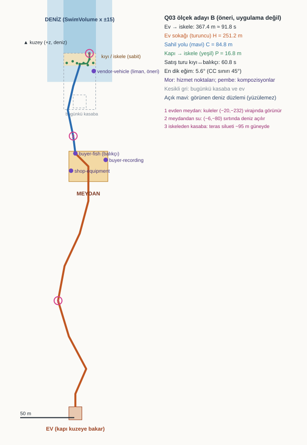

# Q03 — Ev, şehir merkezi, sahil yolu ve liman için ölçek çizimi (hazırlık)

21 Ekim 2026, Utku (B). Taban `codex/p4-integration` @ `d196c11`. Bu belge [WORLD_QUALITY_DELIVERIES](../plan/WORLD_QUALITY_DELIVERIES.md) Q03'ün kapılar beklerken izin verilen **ölçek çizimi** hazırlığıdır. Oyun kodu, sahne, Layout, anchor veya servis konumu değişmedi. Bu belge Q03 kabulü değildir, #141/#159 kapısını açmaz ve P4.10'u başlatmaz. Sayılar öneri ve model sonucudur; gerçek kontrolcüyle ölçülmüş blokaj değildir.

Tekrar üretim: `python -I docs/reports/evidence/p4-q03-scale/q03_scale.py`. Script yalnız standart kütüphaneyi kullanır. Rotalar, mesafeler, tempo tablosu ve çizim tek bir veri kaynağından üretilir. Çıktılar: [q03-tempo.json](evidence/p4-q03-scale/q03-tempo.json) ve [q03-plan.svg](evidence/p4-q03-scale/q03-plan.svg).

## 1. Neden ölçek tek başına karar değil

Plandaki aday ev–iskele arasında 300–500 m. Bugün bu yol 58,6 m; aday, bugünkü yolun 5–9 katı ([#172](P4-ROUTE-172.md)). Kodda tempoyu bağlayan sabitler:

| Sabit | Değer | Kaynak |
|---|---|---|
| Yürüme / yüzme | 4 m/s / 3 m/s, koşma yok | `NetworkDiver.prefab` walkSpeed/swimSpeed |
| Tank | 120 s (1/s) | `NetworkDiver.prefab` maxOxygen/oxygenDrainPerSecond |
| Gün | 08:00–24:00 = **1200 s** gerçek süre | `DayEngine.GameMinutesPerRealSecond` = 960 / (20·60) |
| Uyarılar | 22:00 → 00:00'a **150 s**, 23:00 → **75 s** kala | `DayIds.FirstWarningMinute/SecondWarningMinute` |
| 00:00 | Denizde kalan dalış başarısız. Satış/alışveriş/yayın kabul edilmez. Sabah herkes evde başlar | [WORLD_SYSTEMS](../plan/WORLD_SYSTEMS.md) 00:00 sınırı |
| Çanta | 20 kg; balık 0,9–2,6 kg (8–20 balık) | `InventoryManager.CapacityGrams`, `Species/*.asset` |

Bundan iki sonuç çıkıyor:
- **Ev mesafesi günde iki kez ödenir:** sabah evden çıkışta ve isteğe bağlı akşam dönüşünde. 00:00'da evde olmak gerekmez.
- **Kıyı ile balıkçı arası mesafe her satışta iki kez ödenir.** 23:00 uyarısından sonra satış yapılabilmesi de bu mesafeye bağlıdır. Çanta dalışı sınırlamaz, oksijen sınırlar.

Bu yüzden 300–500 m'nin nasıl bölündüğü, toplam uzunluktan daha önemli.

## 2. Tempo modeli

Tanımlar:
- H = ev kapısından meydan üstünden balıkçıya.
- C = balıkçıdan `Beach_TownGate`'e.
- P = kapıdan iskeleye; bütün adaylarda aynı rota, 16,8 m.
- Ev içi 14,5 m (#172).

Varsayımlar ölçüm değildir; scriptin `TEMPO` sözlüğünde durur:
- Dalış döngüsü 120 veya 180 s.
- Satış 10 s, sabah ekipman 15 s, akşam PC + yatak 30 s.
- 22:00'de sudaki oyuncunun çıkış payı 60 s.
- Sabah: ev → ekipman → kıyı. Akşam: kıyı → balıkçı → ev.

| Aday | H | C | Ev→iskele | Satış gidiş-dönüş | Günde dalış, her dalıştan sonra satış (120 / 180 s) | İki dalışta bir satış (120 s) | 23:00'te sudan çıkış → balıkçı |
|---|---|---|---|---|---|---|---|
| Bugün (model) | 15 m | 14 m | 60 m · 15 s | 26 s | 7 / 5 | 8 | 18 s ✔ |
| **B — önerilen** | 251 m | **85 m** | **367 m · 92 s** | **61 s** | **5 / 4** | 6 | 35 s ✔ |
| B+ — ilk çizim (balıkçı meydanın arkasında) | 210 m | 125 m | 366 m · 92 s | 81 s | 4 / 3 | 6 | 46 s ✔ |
| A — merkez kıyıya yakın | 258 m | 68 m | 358 m · 89 s | 52 s | 5 / 4 | 6 | 31 s ✔ |
| C — merkez evin yanında | 64 m | 263 m | 358 m · 89 s | 150 s | 3 / 2 | 5 | **80 s ✘** (> 75 s) |
| D — 500 m üst sınır | 416 m | 85 m | 533 m · 133 s | 61 s | 4 / 3 | 5 | 35 s ✔ |

Modelin bugünkü ev→iskele değeri (60,5 m) #172'deki gerçek sürüşle (58,6 m) uyumlu. Okuma:
- **C reddedilir.** Uzun sahil yolu satış başına 2,5 dakika ekler ve 23:00 uyarısından sonra satışı imkânsızlaştırır.
- **B+ ile B arasındaki fark yalnız balıkçının yeri.** Aynı 366 m'lik ev–iskele yolunda balıkçıyı meydanın kıyıya bakan köşesine almak günde bir dalış kazandırıyor.
- **A tempo bakımından en iyisi**, ama 68 m'lik sahil yolu ayrı ve okunur bir bölge olmakta zorlanır.
- B, satış turunu 1 dakikada tutarken yaklaşık 85 m'lik ayrı bir sahil yolu bırakır.
- **D** (500 m) dalış sayısını değil, sabah ve akşam yürüyüşünü uzatır (+41 s).
- Bütün adaylarda dalış dışı süre bugünkü %30'dan %50'ye çıkıyor. Plandaki uyarı burada somutlaşıyor: ilk gelir ve tekrar sayısı gerçek turda ölçülmeden ölçek kabul edilmez.

## 3. Önerilen çizim: B

Ölçek: 2,2 px/m. Yukarısı +z, yani deniz. Kesikli gri çizgiler bugünkü kasaba ve ev; renkli çizgiler öneri.

| Bölge | Konum önerisi (x, z) | Yükseklik | Kompozisyon |
|---|---|---|---|
| Liman / kumsal | **değişmez**: kıyı z −15…−3,5; iskele, DiveExit, S1 kızağı, üç parça ve `repair-drop-0` aynı yerde | 8,4 | 3 — iskeleden güneye bakınca ~95 m'de kasaba silueti |
| Sahil yolu (C, 85 m) | `Beach_TownGate` (0, −13,5) → (−6, −34) → (−11, −56) → sırt (−6, −80) → balıkçı (−4, −96) | 8,4 → 14,0, en dik 5,6° | 2 — meydandan inerken (−6, −80) sırtında deniz açılır |
| Meydan | x −10…26, z −122…−94 (36 × 28 m) | 14,0 | Balıkçı kıyıya bakan kuzeybatı köşesinde (−4, −96), ekipman (−8, −112), kayıt alıcısı (24, −102) |
| Liman hizmeti | `vendor-vehicle` kıyıda, iskele köküne yakın (13, −20) öneri | 8,4 | "Liman hizmeti kıyıda kalabilir" kararına uygun |
| Ev sokağı (H, 251 m) | meydan güneyi (8, −122) → (0, −170) → (−14, −200) → viraj (−20, −232) → (−10, −265) → (6, −295) → kapı (−4, −318) | 14,0 → 15,4 | 1 — evden çıkınca meydanın kuleleri (−20, −232) virajında görünür |
| Ev | kapı (−4, −330), ev x −10…2, z −342…−330 (bugünkü 12 × 12 m ev aynen, yönü aynı) | 15,4 | Kapı kuzeye, kasabaya ve denize bakar |

Hizmetler arası mesafe:
- Balıkçı → ekipman ≈ 16 m (≈ 4 s).
- Balıkçı → kayıt ≈ 28 m (≈ 7 s).
- Kapı dahil, plandaki 10–25 s hizmet turu adayının içinde.

Dünyanın kapladığı alan x −20…26 (kıyı ±15 ile), z −342…−3,5. Bugün z −55,5'e kadar iniyor; yeni zemin tamamen `SwimVolume`'ün güneyinde, yüzülebilir alana dokunmuyor. Bugünkü cadde ve meydan zemini (z −15…−55) sahil yolunun ilk ~40 m'sine dönüşür. Bugünkü tezgâhlar ve ev bu alandan kalkar.

**Teras (yükseklik) bir seçenektir.** 2. kompozisyondaki "görüş açılması" için merkezin yaklaşık 5,6 m yukarıda olmasını öneriyorum. Ama bugün `ContinuousTownLayout.WalkSurfaceY = 8.4` tek yüzey varsayıyor, zone sınırları da y aralığıyla tanımlı (`HomeMin/HomeMax` y 7,9–11,4). Düz bir ilk blokaj da aynı mesafeleri verir (en dik eğim 5,6° ile 3D uzunluk farkı < 0,3 m). Görüş açılması o zaman bina araları ve virajla kurulur.

## 4. Taşınacaklar ve kimlikler

Hiçbir kimlik değişmez; yalnız konumlar taşınır.
- **Taşınır:** `home-root`, `home-door`, `home-bed-0…3`, `home-storage`, `home-pc`, `home-spawn-0…3`, `bed-*:exit`, `town-square`, `town-service-slot-0…3` ve dört servis müşteri noktası.
- **Taşınmaz:** kıyı/su tarafındaki bütün anchor'lar (`dock-town-1`, DiveExit, wade/rampa, `boat-part-*`, `repair-*`, rota wp'leri).
- **Değişmez:** dört servis sayısı, D07 sabah yerleşimi ve eski kayıt kimlikleri.

Uygulama aşamasında koordinat sabiti değişecek dosyalar (`ContinuousTownLayout.`, `HomeOrigin`, sabit kasaba koordinatları; 25 dosya):

| Alan | Dosyalar | Sahip / inceleme |
|---|---|---|
| Yerleşim ve ev | `ContinuousTownLayout`, `HomeSceneSetup`, `HomePlayerInteractionBinding`, `SessionNetworkAdapter`, `FishDiveLifecycleBinding` | Mehmet (son değişiklikler), Utku world |
| Kasaba görseli ve dükkân | `TownStorefront`, `SuppliedTownArt`, `CoastalHarborLink` | Mert / Mehmet |
| Sözleşme | `Core/P46WorldContracts` | Utku; zone sınırları ortak |
| Ölçüm araçları | `P4RouteAudit`, `P4PlayerScaleAudit`, `P48RepairAreaAudit`, `P4EngineShoreAudit`, `P4WadeUndersideAudit` | Utku |
| Testler ve smoke sürücüleri | `ContinuousTown*Tests`, `HomeRigAnchorTests`, `P4RouteBaselineTests`, `P4PlayerScaleBaselineTests`, `BoatPartReachabilityTests`, `P4WadeUndersideTests`, `PlayerZoneRulesTests`, `ContinuousWorld/Integrated/ProductDaySmokeDriver` | Her sürücü ve test kendi sahibinde |

Smoke sürücülerindeki sabit kara yolları (ör. `IntegratedSmokeDriver`'daki kıyı waypoint'leri) 300 m'lik yolda geçersiz olur. Blokajla birlikte rota-tabanlı yürüyüşe geçmeleri gerekir; aksi halde CI'daki 1/2/4 süreç testleri kırılır.

## 5. Açık kararlar

| Karar | Önerim | Karar sahibi |
|---|---|---|
| Ölçek bölümü (B / A / B+) | B ile blokaj; satış turu 1 dk'yı aşarsa A'ya kaydır (merkezi kıyıya ~17 m yaklaştırmak) | Mehmet (tasarım son kararı), Mert ekonomi |
| Teras mı düz mü | İlk blokaj düz; teras 2. kompozisyon değerlendirmesinden sonra | Mehmet kamera, Mert sanat |
| `vendor-vehicle` limanda mı | Kıyıda (13, −20) | Mert servis, Mehmet tekne |
| Harita kapsamı | Kasaba `DiveRegionField` dışında kalır; yön için dünya içi işaret yeterli | Mehmet / Mert harita UI |
| Hız | 4 m/s korunur; yol ve tempo önce ölçülür | Mehmet |
| Gün süresi | 1200 s korunur; günde 5 dalış (bugün 7) kabul edilecek mi? | Mert ekonomi, kullanıcı testi |

## 6. Yapılmayanlar ve sonraki adım

Yapılmadı:
- Gerçek CharacterController blokajı ve 1/2/4 süreç turu.
- Görüş hattı ölçümü (kompozisyonlar şimdilik öneri).
- Gece okunurluğu, kare süresi.
- Gerçek av/satış turu ve kullanıcı değerlendirmesi.

SVG ilk sürümü tarayıcıda görüldü; son kenar boşluğu düzeltmesinden sonraki hâli ekranda kontrol edilmedi.

Sonraki adım, #141/#159 kapıları açıldıktan ve karar sahipleri bölümü seçtikten sonra:
1. `P4RouteAudit` aynı araçla seçilen rotayı yürür.
2. Blokaj zemini kurulur.
3. Satış/av turu gerçek süreçlerde ölçülür.

Bu belge o adımların hiçbirini başlatmaz.
